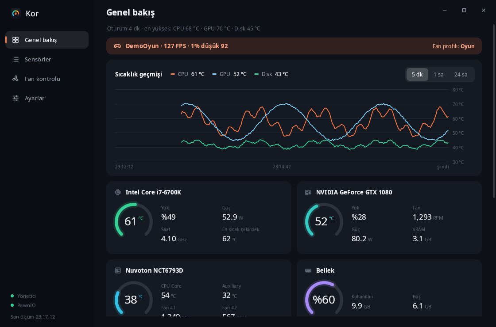
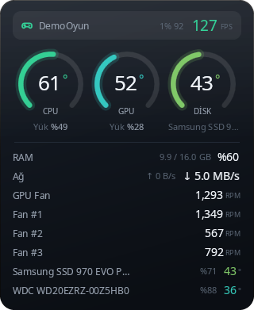
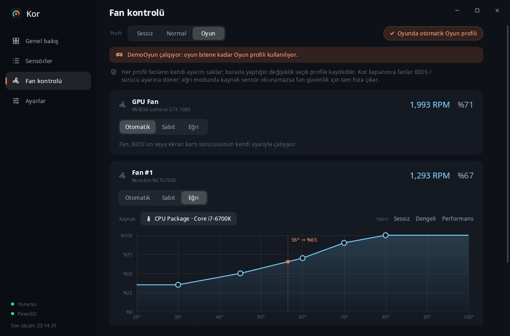
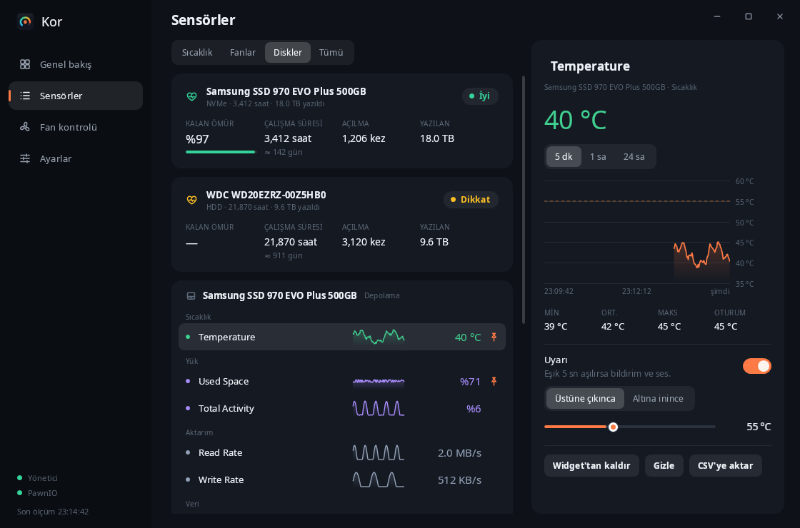

<p align="center">
  
</p>

<h1 align="center">Kor</h1>

<p align="center">
  Windows için sıcaklık, fan, disk ve FPS izleyici.<br>
  Bilgisayarının ısısını masaüstünde küçük bir widget'ta gösterir, fanları senin eğrinle döndürür.
</p>

<p align="center">
  <a href="https://github.com/MihrimatriX/kor/releases/latest"><b>İndir</b></a>
  &nbsp;&nbsp;|&nbsp;&nbsp;
  <a href="https://mihrimatrix.github.io/kor/">Web sitesi</a>
  &nbsp;&nbsp;|&nbsp;&nbsp;
  <a href="#kaynaktan-derleme">Kaynaktan derleme</a>
</p>

<p align="center">
  <a href="https://github.com/MihrimatriX/kor/releases/latest"></a>
  <a href="https://github.com/MihrimatriX/kor/releases"></a>
  
  <a href="LICENSE"></a>
</p>

<p align="center">
  
</p>

## İndir

[Son sürüm](https://github.com/MihrimatriX/kor/releases/latest) sayfasından:

| Dosya | Ne zaman |
|---|---|
| `Kor-Setup-x.y.z.exe` | Önerilen. Program Files'a kurar, Başlat menüsüne ekler, istersen PawnIO sürücüsünü de kurar. |
| `Kor-x.y.z-portable.exe` | Kurulumsuz tek dosya. |

İkisi de .NET çalışma zamanını içinde taşır. Exe henüz imzalı olmadığı için SmartScreen uyarı verebilir: **Ek bilgi › Yine de çalıştır**.

## Neler yapar



- **Widget'lar:** En fazla 4 tane; halka, liste ya da tek satırlık şerit. Masaüstünde, hep üstte ya da sadece oyunda üstte.
- **Fan kontrolü:** Otomatik, sabit yüzde ya da sürüklenebilir eğri. Sessiz / Normal / Oyun profilleri; oyun açılınca Oyun profiline geçer.
- **Oyunda FPS:** FPS ve 1% düşük, DirectX 9–12 (ETW ile, oyunun içine girmeden).
- **Akıllı uyarılar:** Aşırı ısınma, herhangi bir sensöre özel eşik, duran fan, dolan disk, kötüleşen SMART.
- **Disk sağlığı:** İyi / Dikkat / Kötü, kalan ömür, çalışma süresi, yazılan veri.
- **Telefondan izleme:** Aynı ağdaki telefondan QR kodla açılan, salt okunur web paneli.
- **Geçmiş:** 24 saatlik grafikler, 7 günlük kayıt, CSV'ye aktarma.
- **Görünüm:** Koyu / açık / Windows'u izle, 6 vurgu rengi.
- **Telemetri yok.** Tek dış bağlantı, kapatılabilen güncelleme denetimi.

<br clear="right">

| Fan eğrileri ve profiller | Disk sağlığı ve sensöre özel uyarı |
|---|---|
|  |  |

### Fan kontrolü güvenliği
- Kor kapanınca (normal çıkış, oturum kapanması, kaldırma) tüm fanlar BIOS / sürücü kontrolüne geri verilir.
- Eğri modunda kaynak sensör okunamazsa fan tam hıza çıkar.
- Değişimler yumuşatılır (hızlanma hızlı, yavaşlama yavaş) ve küçük düşüşler yok sayılır, fan sürekli inip çıkmaz.
- Anakart fanlarını kontrol etmek için yönetici izni + PawnIO gerekir; bazı anakartlar yazılımla kontrolü desteklemez.

## Kaynaktan derleme

Gerekenler: Windows 10/11, [.NET 10 SDK](https://dotnet.microsoft.com/download/dotnet/10.0).

```powershell
# Geliştirme (yönetici izni sorulur; reddedersen sınırlı modda açılır)
dotnet run

# Donanım okumadan, sahte verilerle arayüzü görmek için
dotnet run -- --demo

# Taşınabilir tek dosya (çalışma zamanı içinde)
dotnet publish Kor.csproj -c Release -r win-x64 --self-contained true `
  -p:PublishSingleFile=true -p:IncludeNativeLibrariesForSelfExtract=true `
  -p:EnableCompressionInSingleFile=true -o artifacts/portable

# Kurulum dosyası (Inno Setup 6.7+)
ISCC.exe /DAppVersion=0.3.0 installer\Kor.iss   # → artifacts\Kor-Setup-0.3.0.exe
```

### Yeni sürüm yayımlama

1. `Kor.csproj` içindeki `<Version>`'ı artır, `release-notes/vX.Y.Z.md` dosyasını yaz.
2. GitHub'da **Releases › Draft a new release**, etiket `vX.Y.Z`, notu yapıştır, **Publish**. Ya da:

   ```powershell
   gh release create v0.3.1 --title "Kor v0.3.1" --notes-file release-notes/v0.3.1.md
   ```

GitHub Actions (`.github/workflows/release.yml`) sürüm yayımlanınca Windows'ta taşınabilir exe ile kurulumu derler,
SHA-256 toplamlarını çıkarır ve dosyaları o sürüme ekler. Uygulama açılışta yeni sürümü fark edip Ayarlar › Hakkında'da gösterir.

Komut satırı argümanları:

| Argüman | Etkisi |
|---|---|
| `--demo` | Sahte sensör verisi + 90 sn açık / 30 sn kapalı sahte oyun (yönetici izni istemez) |
| `--tray` | Detay penceresini açmadan başlar (otomatik başlatmada kullanılır) |
| `--no-elevate` | Yönetici izni istemeden başlar |
| `--exit` | Çalışan Kor'u düzgünce kapatır (kurulum/kaldırma kullanır; fanlar BIOS'a döner) |

## Tam sensör listesi için gerekenler

| Gereksinim | Ne açılır |
|---|---|
| **Yönetici izni** | Disk sıcaklıkları (SMART), CPU ve anakart sensörleri |
| **PawnIO sürücüsü** | CPU sıcaklığı (MSR), anakart fanları ve sıcaklıkları (Super I/O) |

PawnIO'yu kurmak için: `winget install --id namazso.PawnIO -e` ya da https://pawnio.eu.
Uygulamadaki uyarı bandında bunun için tek tıklık bir düğme de var.
Ekran kartı sıcaklıkları ve fanları (NVIDIA/AMD) sürücü kurmadan okunur.

> Not: PawnIO, LibreHardwareMonitor'un eski WinRing0 sürücüsü yerine kullandığı imzalı bir çekirdek sürücüsü.
> Bazı hile karşıtı yazılımlar (ör. FACEIT) çekirdek sürücülerine hassas davranabilir.

**Windows ile başlat:** Görev Zamanlayıcı'da "en yüksek ayrıcalıklarla" bir oturum açılışı görevi oluşturur.
Bu yüzden her açılışta UAC sorulmaz. Run kayıt anahtarı yönetici yetkisi veremediği için bu yol seçildi.

**FPS notları:** Ölçüm yönetici izni ister (ETW oturumu). Pencereli / kenarlıksız tam ekran oyunlarda widget oyunun üstünde görünür;
özel (exclusive) tam ekranda ölçüm çalışır ama hiçbir normal pencere oyunun üstüne çizilemez. Vulkan/OpenGL oyunları
DXGI üzerinden sunum yapmıyorsa FPS görünmeyebilir.

**Telefondan izleme:** Windows Güvenlik Duvarı ilk açılışta izin sorar; sadece "Özel ağlar"a izin vermen yeterli.
Bağlantı kodu değiştirilince eski QR / adres çalışmaz.

## Mimari

```
Core/
  SensorService.cs      LibreHardwareMonitor'u tek bir arka plan thread'inde okur → değişmez HardwareSnapshot (+ SMART özeti)
  FanControl.cs         Fan eğrisi modeli + FanController (yumuşatma, histerezis, güvenli geri dönüş)
  Games.cs              Oyun algılama, ETW FPS ölçümü, FPS'i "Oyun" sanal donanımı olarak sensörlere ekleme
  RemoteServer.cs       TcpListener tabanlı küçük HTTP sunucusu + QR kod (telefondan izleme)
  ThemeManager.cs       Koyu/açık tema ve vurgu rengi (Application.Resources üzerinden DynamicResource)
  History.cs            SensorHistory (1 sa saniyelik + 24 sa dakikalık), diske kayıt/okuma, CSV dışa aktarma
  DemoSensorService.cs  --demo için sahte veri kaynağı
  AppSettings.cs        Ayarlar (widget listesi, fan profilleri, uyarı kuralları...) + eski sürüm ayarlarını taşıma
  SystemAccess.cs       Yönetici izni, PawnIO tespiti, Görev Zamanlayıcı, tek örnek kilidi
  Display.cs            Türkçe biçimlendirme (%45, 4,20 GHz) ve sıcaklık → renk ölçeği
ViewModels/
  MainViewModel*.cs     Çekirdek + .Widgets (widget içerikleri) + .Alerts (uyarı motoru) + .Features (profil, oyun, disk sağlığı, uzaktan izleme, tema)
  WidgetViewModel.cs    Tek widget penceresinin içeriği (sensör nesneleri ortak)
  SensorItem.cs         Tek sensörün UI modeli (yerinde güncellenir, geçmişini tutar)
  DiskHealthItem.cs     SMART özeti kartı
  WidgetRow.cs          Widget satırı (liste/şerit/halka özetleri, FPS)
  FanControlItem.cs     Fan kontrol kartı + sürüklenebilir eğri noktaları
Controls/               RingGauge, BarMeter, Sparkline, Icon, HistoryChart, FanCurveEditor (OnRender)
Views/                  WidgetWindow (her widget için bir pencere), DetailsWindow
Tray/TrayIcon.cs        NotifyIcon + temaya uygun WPF menü (alt menüler), dinamik sıcaklık ikonu
Assets/remote.html      Telefon paneli (gömülü kaynak, bağımlılıksız)
Core/UpdateChecker.cs   GitHub Releases'tan yeni sürüm denetimi (sadece haber verir, indirmez)
installer/Kor.iss       Inno Setup kurulum betiği (PawnIO seçeneği, "--exit" ile güvenli kapatma)
docs/                   GitHub Pages sitesi (tek HTML, canlı widget örneği)
.github/workflows/      build.yml (her push), release.yml (sürüm yayımlanınca → exe + kurulum + SHA256SUMS)
```

Veri akışı: `SensorService (arka plan thread)` → `HardwareSnapshot` → `Dispatcher.BeginInvoke`
(sadece en son ölçüm işlenir, FPS "Oyun" donanımı olarak eklenir) → `MainViewModel.Apply` → `SensorItem`'lar yerinde güncellenir
→ uyarılar, widget'lar, telefon JSON'u → binding'ler.

### Unity karşılıkları

| Kor (WPF) | Unity |
|---|---|
| `SensorService` arka plan thread'i + Dispatcher | Worker thread + ana thread'e kuyrukla aktarım (Unity API'si de ana thread ister) |
| `RingGauge.OnRender` | `Image.fillAmount` (Radial) veya özel UI mesh'i |
| `DoubleAnimation` (halka geçişi) | DOTween / `Mathf.SmoothDamp` |
| `INotifyPropertyChanged` + Binding | UI Toolkit runtime binding / elle `text = ...` |
| `DataTemplate` | Prefab |
| `FanCurveEditor` | `AnimationCurve` editörü (sabit 5 nokta, doğrusal) |
| `FanController` yumuşatma | `Mathf.MoveTowards` ile hedef değere sınırlı adım |
| Birden fazla `WidgetViewModel` | Aynı veri modeline bağlı birden çok Canvas prefab örneği |
| `ThemeManager` + DynamicResource | UI Toolkit USS değişkenleri / tema ScriptableObject'i |
| ETW Present olayları | Unity Profiler'ın frame timing'i (ama süreç dışından) |

## Lisans

Kor [MIT lisanslı](LICENSE). Kullandığı kütüphaneler:

Sensör okuma: [LibreHardwareMonitorLib](https://github.com/LibreHardwareMonitor/LibreHardwareMonitor) (MPL-2.0).
FPS: [Microsoft.Diagnostics.Tracing.TraceEvent](https://github.com/microsoft/perfview) (MIT). QR kod: [QRCoder](https://github.com/codebude/QRCoder) (MIT).
