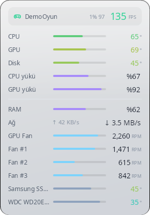
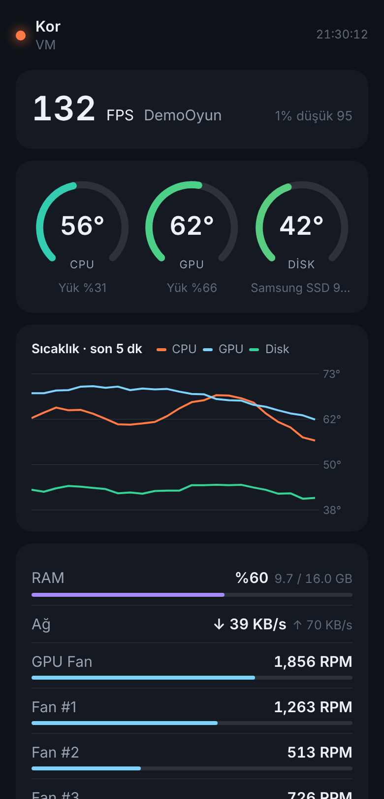
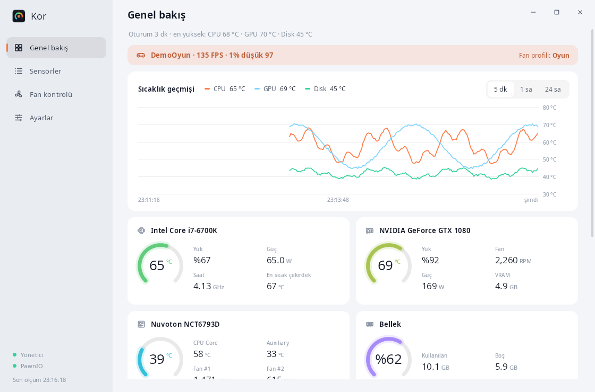
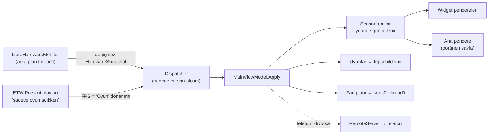

<p align="center">
  
</p>

<h1 align="center">Kor</h1>

<p align="center">
  <b>Windows için sıcaklık, fan, disk ve FPS izleyici.</b><br>
  Bilgisayarının ısısını masaüstünde küçük bir widget'ta gösterir, fanları senin eğrinle döndürür,<br>
  bir şey fazla ısınınca haber verir.
</p>

<p align="center">
  <a href="https://github.com/MihrimatriX/kor/releases/latest"><b>⬇ İndir</b></a>
  &nbsp;·&nbsp;
  <a href="https://mihrimatrix.github.io/kor/">Web sitesi</a>
  &nbsp;·&nbsp;
  <a href="#sık-sorulanlar">SSS</a>
  &nbsp;·&nbsp;
  <a href="#geliştirme">Geliştirme</a>
  &nbsp;·&nbsp;
  <a href="#english">English</a>
</p>

<p align="center">
  <a href="https://github.com/MihrimatriX/kor/releases/latest"></a>
  <a href="https://github.com/MihrimatriX/kor/releases"></a>
  <a href="https://github.com/MihrimatriX/kor/actions/workflows/build.yml"></a>
  
  
  <a href="LICENSE"></a>
</p>

<p align="center">
  
</p>

## İçindekiler

- [Hızlı başlangıç](#hızlı-başlangıç)
- [Özellikler](#özellikler)
- [Gereksinimler](#gereksinimler)
- [Sık sorulanlar](#sık-sorulanlar)
- [Gizlilik ve güvenlik](#gizlilik-ve-güvenlik)
- [Geliştirme](#geliştirme)
- [Mimari](#mimari)
- [Katkı](#katkı)
- [Lisans ve teşekkür](#lisans-ve-teşekkür)

## Hızlı başlangıç

1. [Son sürüm](https://github.com/MihrimatriX/kor/releases/latest) sayfasından **`Kor-Setup-x.y.z.exe`**'yi indir ve çalıştır.
2. Kurulumda **"PawnIO sürücüsünü kur"** işaretli kalsın (CPU sıcaklığı ve anakart fanları için gerekli).
3. Kor açılınca sağ üstte widget belirir. Çift tıklayınca ana pencere açılır; sağ tıkla mod, konum ve tema değişir.

| Dosya | Kimin için |
|---|---|
| `Kor-Setup-x.y.z.exe` | **Önerilen.** Program Files'a kurar, Başlat menüsüne ekler, isteğe bağlı PawnIO'yu kurar. Daha hızlı açılır, daha az bellek kullanır. |
| `Kor-x.y.z-portable.exe` | Kurulumsuz tek dosya; USB bellekte taşımak ya da denemek için. |
| `SHA256SUMS.txt` | İndirdiğin dosyanın değişmediğini doğrulamak için: `Get-FileHash Kor-Setup-x.y.z.exe` |

İkisi de .NET çalışma zamanını içinde taşır; ayrıca bir şey kurman gerekmez.

> [!NOTE]
> Exe henüz kod imzalı değil. Windows SmartScreen "Windows bilgisayarınızı korudu" derse **Ek bilgi › Yine de çalıştır**.

## Özellikler

### Widget'lar

<p>
  
  &nbsp;
  
  &nbsp;
  
</p>


- **Üç görünüm:** halkalar, çubuklu liste ya da ekranın kenarına yaslanan tek satırlık şerit.
- **En fazla 4 widget**, her birinin içeriği, boyutu, saydamlığı ve konumu ayrı.
- **Konum:** masaüstünde (Win+D'de bile görünür), hep üstte ya da **sadece oyun açıkken üstte** (FPS overlay).
- Tıklamaları geçirebilir, konumu kilitlenebilir. Sensörler sayfasından istediğin sensörü widget'a ekleyip çıkarabilirsin.

### İzleme

- **Sıcaklıklar:** CPU, ekran kartı, anakart, diskler (NVMe/SSD/HDD), soğutucular. Renk ölçeği eşiklerine göre maviden kırmızıya.
- **Fanlar ve yük:** fan hızları, CPU/GPU yükü, RAM, ağ hızı, disk okuma/yazma, güç ve saat hızları.
- **Oyunda FPS:** FPS, 1% düşük ve kare süresi. DirectX 9–12 oyunlarda ETW ile, oyunun içine hiçbir şey enjekte etmeden.
- **Geçmiş:** 5 dakika / 1 saat / 24 saat grafikleri, 7 günlük kayıt, CSV'ye aktarma (Excel'de doğru açılır).
- **Disk sağlığı:** SMART'a göre İyi / Dikkat / Kötü, kalan ömür, çalışma süresi, toplam yazılan veri.
- **Telefondan izleme:** aynı Wi-Fi'deki telefonda QR kodla açılan, salt okunur panel. Uygulama kurmak gerekmez.

### Kontrol ve uyarılar


- **Fan kontrolü:** her fan için otomatik (BIOS), sabit yüzde ya da sürüklenebilir 5 noktalı eğri. Eğrinin kaynağı istediğin sıcaklık sensörü.
- **Profiller:** Sessiz / Normal / Oyun. Oyun algılanınca kendiliğinden Oyun profiline geçer, oyun bitince geri döner.
- **Akıllı uyarılar:** aşırı ısınma, herhangi bir sensöre koyduğun özel eşik, duran fan, dolmak üzere olan disk, kötüleşen SMART. Bildirim + isteğe bağlı ses; aynı uyarı tekrar tekrar çalmaz.

**Fan kontrolü güvenliği:**
- Kor nasıl kapanırsa kapansın (çıkış, oturum kapanması, güncelleme, kaldırma) fanlar BIOS / sürücü kontrolüne geri verilir.
- Eğri modunda kaynak sensör okunamazsa fan tam hıza çıkar.
- Hız değişimleri yumuşatılır (hızlanma çabuk, yavaşlama yavaş) ve küçük düşüşler yok sayılır; fan sürekli inip çıkmaz.

### Görünüm ve kullanım



- Koyu, açık ya da Windows'u izleyen tema; 6 vurgu rengi. Windows 11'de yuvarlak köşeler ve koyu başlık çubuğu.
- Tepsi ikonunda canlı CPU sıcaklığı (isteğe bağlı), sensörleri yeniden adlandırma ve gizleme.
- Windows ile başlatma (her açılışta UAC sorusu çıkmadan), yeni sürüm bildirimi.
- **Hafif:** sensörler ayrı bir thread'de okunur; arayüz sadece değişen değerleri yeniden çizer, gizli pencere ve sayfalar için iş yapılmaz, FPS ölçümü sadece oyun açıkken çalışır.

## Gereksinimler

| | |
|---|---|
| **İşletim sistemi** | Windows 10 (1809 ve sonrası) ya da Windows 11, 64 bit |
| **Yönetici izni** | CPU ve anakart sensörleri, disk sıcaklıkları (SMART), fan kontrolü ve FPS için. Reddedersen Kor sınırlı modda (sadece GPU, RAM, ağ gibi sensörlerle) açılır. |
| **[PawnIO](https://pawnio.eu) sürücüsü** | CPU sıcaklığı (MSR) ile anakart fanları ve sıcaklıkları (Super I/O) için. Kurulum bunu sunar; sonradan da Kor'daki uyarı bandından tek tıkla ya da `winget install --id namazso.PawnIO -e` ile kurabilirsin. |

Ekran kartı sıcaklıkları ve fanları (NVIDIA / AMD / Intel) ek sürücü olmadan okunur.

## Sık sorulanlar

<details>
<summary><b>CPU sıcaklığı "—" görünüyor ya da anakart fanları yok.</b></summary>

Kor'un yönetici olarak çalıştığından ve PawnIO'nun kurulu olduğundan emin ol (ana penceredeki sol alt köşede ikisi de yeşil olmalı).
PawnIO'yu yeni kurduysan Kor'u yeniden başlat. Hâlâ yoksa işlemcin ya da anakartının Super I/O yongası
LibreHardwareMonitor tarafından henüz desteklenmiyor olabilir.
</details>

<details>
<summary><b>Fan hızını değiştiremiyorum.</b></summary>

Fan sayfasında sadece yazılımla kontrol edilebilen fanlar listelenir. Bazı anakartlar (özellikle hazır sistemler ve dizüstüler)
fan kontrolünü BIOS'a kilitler. BIOS'ta fanın "PWM"/"DC" modunda ve "Smart Fan" yerine "Manual"/"Full" olmayan bir modda olduğunu da kontrol et.
</details>

<details>
<summary><b>Oyunda FPS görünmüyor.</b></summary>

- FPS ölçümü yönetici izni ister ve Ayarlar'da açık olmalı.
- Oyun algılanmalı: oyunu **Ayarlar › Oyunlar** listesine ekle ya da "tam ekran pencereyi oyun say" seçeneğini aç.
- Vulkan / OpenGL oyunlar DXGI üzerinden sunum yapmıyorsa FPS görünmeyebilir.
- Özel (exclusive) tam ekranda ölçüm çalışır ama hiçbir normal pencere oyunun üstüne çizilemez; widget'ı görmek için oyunu kenarlıksız pencere moduna al.
</details>

<details>
<summary><b>Hile karşıtı yazılımlar (anti-cheat) sorun çıkarır mı?</b></summary>

Kor oyunun belleğine dokunmaz ve içine bir şey enjekte etmez; FPS'i Windows'un kendi olay izleme altyapısından (ETW) okur.
Sensör okumak için kullanılan PawnIO imzalı bir çekirdek sürücüsüdür, ama bazı katı anti-cheat sistemleri (ör. FACEIT) çekirdek sürücülerine
hassas davranabilir. Sorun yaşarsan o oyunu oynarken Kor'u kapatabilirsin.
</details>

<details>
<summary><b>Antivirüs uyarı veriyor.</b></summary>

Donanım izleyiciler düşük seviyeli donanım erişimi kullandığı için bazen yanlış alarm alır. Exe'leri GitHub Actions açık iş akışıyla
bu depodan derleniyor; `SHA256SUMS.txt` ile indirdiğin dosyayı doğrulayabilir ya da [kaynaktan kendin derleyebilirsin](#geliştirme).
</details>

<details>
<summary><b>Ayarlarım ve geçmişim nerede? Nasıl tamamen kaldırırım?</b></summary>

Her şey `%AppData%\Kor` klasöründe: `settings.json`, `history\` (günlük CSV, 7 gün tutulur) ve hata günlüğü `kor.log`.
Kaldırma bu klasöre dokunmaz (yeniden kurunca ayarların geri gelsin diye); tamamen temizlemek için klasörü sil.
PawnIO ayrı bir programdır, "Uygulamalar"dan ayrıca kaldırılır.
</details>

<details>
<summary><b>Telefon paneli açılmıyor.</b></summary>

Telefon ve bilgisayar aynı ağda olmalı. Windows Güvenlik Duvarı ilk açılışta izin sorar: "Özel ağlar"a izin vermen yeterli.
Sunucu sadece yerel ağ adreslerinden gelen ve doğru bağlantı kodunu taşıyan istekleri kabul eder; kodu yenilersen eski QR çalışmaz.
</details>

## Gizlilik ve güvenlik

- **Telemetri yok.** Kor internete sadece günde en fazla bir kez yeni sürüm var mı diye GitHub'a sorar; bu da Ayarlar'dan kapatılabilir. Hiçbir şey indirmez ya da kendini güncellemez.
- **Telefon paneli varsayılan olarak kapalı**, açıkken salt okunurdur: hiçbir uç nokta ayar değiştiremez ya da fanlara dokunamaz. Sadece özel IP aralıklarından gelen ve rastgele bağlantı kodunu taşıyan istekler kabul edilir.
- **Yönetici izni** sadece sensör ve fan erişimi için. "Windows ile başlat" bunu Görev Zamanlayıcı'daki bir oturum açılışı göreviyle yapar; kaldırınca görev de silinir.

## Geliştirme

Gerekenler: Windows 10/11 ve [.NET 10 SDK](https://dotnet.microsoft.com/download/dotnet/10.0). Proje Linux/macOS'ta da derlenir (`EnableWindowsTargeting`), ama çalıştırmak için Windows gerekir.

```powershell
git clone https://github.com/MihrimatriX/kor.git
cd kor

dotnet run                 # yönetici izni sorulur; reddedersen sınırlı modda açılır
dotnet run -- --demo       # donanım okumadan, sahte verilerle (fan eğrileri ve oyun da simüle edilir)
```

**Komut satırı argümanları:**

| Argüman | Etkisi |
|---|---|
| `--demo` | Sahte sensör verisi + 90 sn açık / 30 sn kapalı sahte oyun; yönetici izni istemez, geçmişi ayrı klasöre yazar |
| `--tray` | Ana pencereyi açmadan başlar (Windows ile başlatmada kullanılır) |
| `--no-elevate` | Yönetici izni istemeden başlar |
| `--exit` | Çalışan Kor'u düzgünce kapatır; fanlar BIOS'a döner (kurulum ve kaldırma kullanır) |

**Paketleme** (CI'da otomatik, elle gerekirse):

```powershell
# Kurulumun içine giren klasör (ReadyToRun: daha hızlı açılış)
dotnet publish Kor.csproj -c Release -r win-x64 --self-contained -p:PublishReadyToRun=true -o artifacts/app
ISCC.exe /DAppVersion=0.3.1 installer\Kor.iss          # → artifacts\Kor-Setup-0.3.1.exe

# Taşınabilir tek dosya
dotnet publish Kor.csproj -c Release -r win-x64 --self-contained -p:PublishSingleFile=true `
  -p:IncludeNativeLibrariesForSelfExtract=true -p:EnableCompressionInSingleFile=true -o artifacts/portable
```

**Yeni sürüm:** `Kor.csproj`'daki `<Version>`'ı artır, `release-notes/vX.Y.Z.md`'yi yaz, sonra GitHub'da sürümü yayımla
(`gh release create vX.Y.Z --notes-file release-notes/vX.Y.Z.md`) ya da **Actions › Release › Run workflow**'u `publish` işaretli çalıştır.
[`release.yml`](.github/workflows/release.yml) Windows'ta kurulumu ve taşınabilir exe'yi derler, SHA-256 toplamlarını çıkarır ve sürüme ekler.
`docs/` klasöründeki değişiklikler [`pages.yml`](.github/workflows/pages.yml) ile siteye kendiliğinden yayımlanır.

## Mimari



```
Core/
  SensorService.cs      LibreHardwareMonitor'u tek thread'de okur → HardwareSnapshot (+ 30 sn'de bir SMART özeti)
  FanControl.cs         Fan eğrisi + FanController (yumuşatma, histerezis, güvenli geri dönüş)
  Games.cs              Oyun algılama, ETW FPS ölçümü, FPS'i "Oyun" sanal donanımı olarak ekleme
  History.cs            SensorHistory (1 sa saniyelik + 24 sa dakikalık halka tampon), günlük CSV kaydı, dışa aktarma
  RemoteServer.cs       TcpListener tabanlı küçük HTTP sunucusu + QR kod
  AppSettings.cs        Ayarlar (widget'lar, fan profilleri, uyarı kuralları) + eski sürüm ayarlarını taşıma
  SystemAccess.cs       Yönetici izni, PawnIO tespiti, Görev Zamanlayıcı, tek örnek kilidi
  ThemeManager.cs       Koyu/açık tema ve vurgu rengi (DynamicResource)
  Display.cs            Türkçe biçimlendirme (%45, 4,20 GHz) ve sıcaklık → renk ölçeği
  UpdateChecker.cs      GitHub Releases'tan yeni sürüm denetimi (sadece haber verir)
  DemoSensorService.cs  --demo için sahte veri kaynağı
ViewModels/
  MainViewModel*.cs     Çekirdek + .Widgets + .Alerts + .Features (profil, oyun, disk sağlığı, telefon, tema, güncelleme)
  SensorItem.cs         Tek sensörün UI modeli (değer değişmedikçe yeniden biçimlenmez)
  WidgetViewModel.cs    Bir widget penceresinin içeriği    WidgetRow.cs   Widget satırı
  FanControlItem.cs     Fan kartı + eğri noktaları         DiskHealthItem.cs   SMART kartı
Controls/               RingGauge, BarMeter, Sparkline, HistoryChart, FanCurveEditor, Icon (hepsi OnRender ile)
Views/                  WidgetWindow (katmanlı, saydam pencere), DetailsWindow
Tray/TrayIcon.cs        NotifyIcon + temaya uygun WPF menüsü, canlı sıcaklık ikonu
Assets/remote.html      Telefon paneli (gömülü, bağımlılıksız)
installer/Kor.iss       Inno Setup betiği (PawnIO seçeneği, "--exit" ile güvenli kapatma)
docs/                   GitHub Pages sitesi
```

<details>
<summary><b>Unity geliştiricileri için karşılıklar</b></summary>

| Kor (WPF) | Unity |
|---|---|
| `SensorService` arka plan thread'i + `Dispatcher` | Worker thread + ana thread'e kuyrukla aktarım (Unity API'si de ana thread ister) |
| `INotifyPropertyChanged` + Binding | UI Toolkit runtime binding / elle `label.text = ...` |
| `DataTemplate` | Prefab |
| `RingGauge.OnRender` | `Image.fillAmount` (Radial) ya da özel UI mesh'i |
| `DoubleAnimation` (halka geçişi) | DOTween / `Mathf.SmoothDamp` (değer değişince kısa tween) |
| `Freeze()` edilmiş fırça | `sharedMaterial` (paylaşılan, değişmeyen malzeme) |
| `FanCurveEditor` | `AnimationCurve` editörü (sabit 5 nokta, doğrusal) |
| `FanController` yumuşatma | `Mathf.MoveTowards` ile hedefe sınırlı adım |
| Birden fazla `WidgetViewModel` | Aynı veri modeline bağlı birden çok Canvas prefab örneği |
| `ThemeManager` + DynamicResource | USS değişkenleri / tema ScriptableObject'i |
| ETW Present olayları | Profiler'daki frame timing (ama süreç dışından) |

</details>

## Katkı

Hata bildirimi ve öneriler için [issue aç](https://github.com/MihrimatriX/kor/issues). Bir sensör yanlış ya da eksik görünüyorsa
işlemci, anakart ve ekran kartı modelini ve mümkünse `%AppData%\Kor\kor.log` dosyasını ekle.

Pull request'ler açık. Kod yorumları ve arayüz metinleri Türkçe; değişikliğini `dotnet run -- --demo` ile denemen yeterli,
[derleme iş akışı](.github/workflows/build.yml) her PR'da çalışır.

## Lisans ve teşekkür

Kor [MIT lisanslı](LICENSE). Üzerine kurulduğu açık kaynak projeler:

- [LibreHardwareMonitor](https://github.com/LibreHardwareMonitor/LibreHardwareMonitor) (MPL-2.0): sensör okuma ve fan kontrolü
- [PawnIO](https://pawnio.eu): imzalı donanım erişim sürücüsü
- [TraceEvent](https://github.com/microsoft/perfview) (MIT): ETW ile FPS ölçümü, [PresentMon](https://github.com/GameTechDev/PresentMon)'un yöntemiyle
- [QRCoder](https://github.com/codebude/QRCoder) (MIT): telefon bağlantısı için QR kod

---

## English

**Kor** is a lightweight Windows 10/11 hardware monitor: temperatures, fan speeds, disk health and in-game FPS on a desktop widget
(rings, list or a one-line strip), custom fan curves with Silent / Normal / Game profiles that switch automatically when a game starts,
smart alerts, 24-hour history with CSV export, and a read-only phone dashboard over your local network. No telemetry.

Download **`Kor-Setup-x.y.z.exe`** from the [latest release](https://github.com/MihrimatriX/kor/releases/latest) and keep
"Install PawnIO" checked for CPU temperatures and motherboard fans. Run as administrator for full sensor access.
The UI is in Turkish for now. Build with the .NET 10 SDK: `dotnet run -- --demo` shows the UI with simulated sensors.
